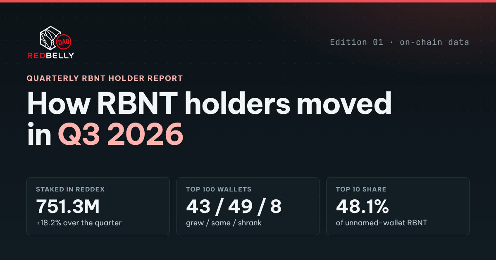
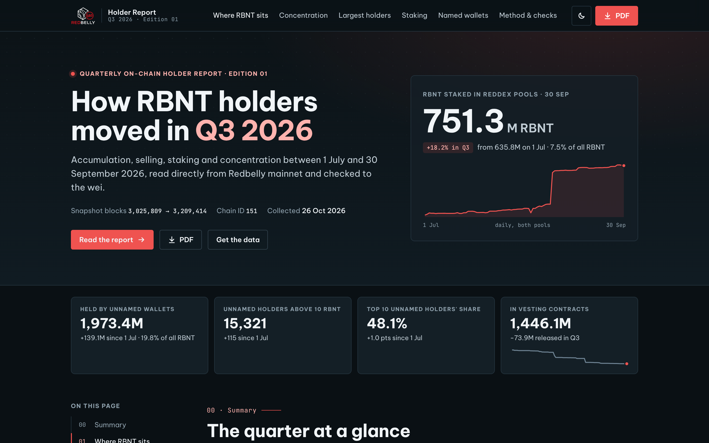
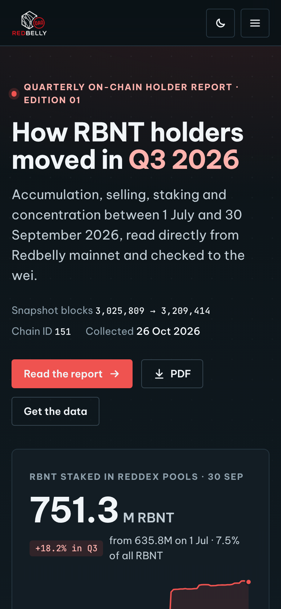
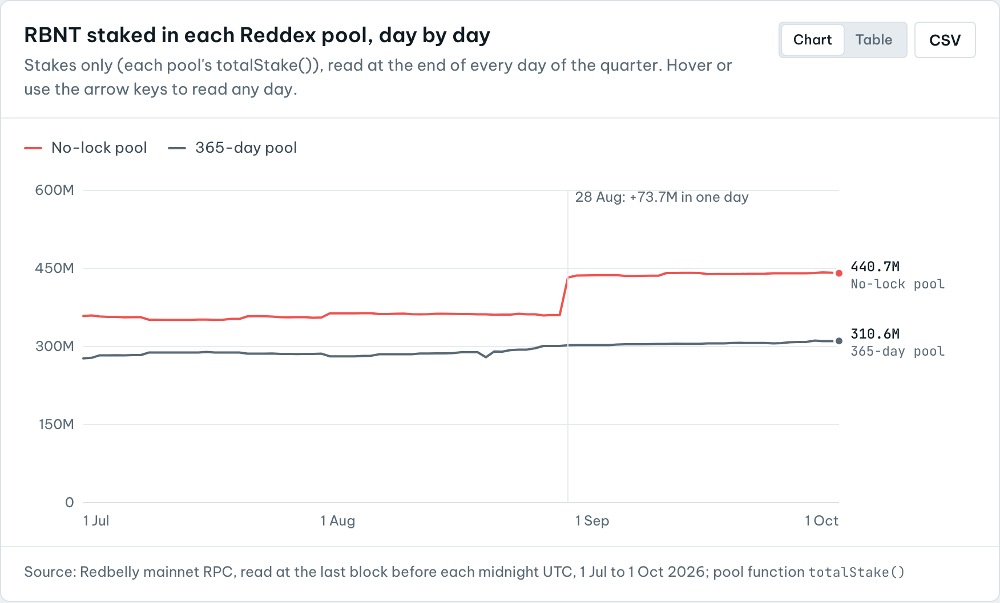
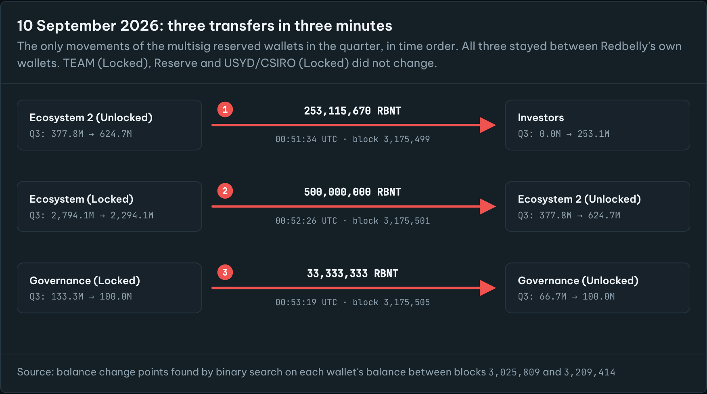

<p align="center">
  <a href="https://redbelly-quarterly-holder-review.vercel.app"></a>
</p>

<h1 align="center">RBNT Holder Report · Q3 2026</h1>

<p align="center">
  <b>How RBNT holders moved between 1 July and 30 September 2026: accumulation, selling, staking and concentration.</b><br>
  Read directly from Redbelly mainnet, checked to the wei, and written so the next edition can repeat it.
</p>

<p align="center">
  <a href="https://redbelly-quarterly-holder-review.vercel.app"></a>
  <a href="report/RBNT-Holder-Report-Q3-2026.pdf"></a>
  <a href="data/"></a>
  <a href="METHOD.md"></a>
  <a href="data/checks.csv"></a>
</p>

---

## The quarter at a glance

| | 1 Jul 2026 | 30 Sep 2026 | Change |
|---|---:|---:|---:|
| RBNT staked in the two Reddex pools | 635.8M | **751.3M** | +115.5M (+18.2%) |
| Wallets with a stake | 1,268 | 1,255 | -13 |
| RBNT held by unnamed wallets (RBNT + WRBNT + staked) | 1,834.3M | **1,973.4M** | +139.1M |
| Unnamed holders with more than 10 RBNT | 15,206 | 15,321 | +115 |
| Share held by the top 10 / top 100 unnamed holders | 47.1% / 75.4% | **48.1% / 76.3%** | +1.0 / +0.9 pts |
| Redbelly reserved wallets | 5,974.8M | 5,931.0M | −43.8M |
| Token vesting contracts | 1,520.0M | 1,446.1M | −73.9M |

* **The largest holders mostly held or added.** Of the 100 largest unnamed wallets on 1 July, **43 grew, 49 stayed about the same and 8 shrank**. Staked RBNT counts as held, so staking is never counted as selling.
* **Reserved wallets moved on one day only.** On 10 September there were three transfers between Redbelly's own wallets, the largest being 500M from Ecosystem (Locked) to Ecosystem 2 (Unlocked). RBNT left the reserved wallets only through Ecosystem (Unlocked): 43.8M net, including 15M added to the staking reward funds.
* **No unnamed wallet is ever singled out.** Wallets are named only when they are already public, and no data file contains the address of an unnamed wallet.

## See it

| Desktop | Mobile |
|---|---|
|  |  |
|  |  |

**[Open the live report →](https://redbelly-quarterly-holder-review.vercel.app)**

## What the web report does

| | |
|---|---|
| **The homepage is the report** | Seven sections in reading order, with a sticky section index, reading progress, deep links to every section and a mobile section menu |
| **Interactive charts** | Hover or keyboard focus on any mark for exact values. Arrow keys step through the daily staking chart, one day at a time |
| **Every chart has a table** | One click switches any chart to its data table, and every chart links to its CSV |
| **Verify on-chain, live** | Key figures have a `Verify` button. Your browser asks the public Redbelly RPC for the same value at the same block and shows whether it **matches**, with a copy-ready `curl` command |
| **Brand kit** | Redbelly DAO Task Board "Kinetic Consensus": deep slate, one red accent, Be Vietnam Pro and JetBrains Mono, tonal depth, light and dark themes |
| **Accessible and fast** | Semantic HTML, skip link, labelled charts, keyboard-reachable tooltips, reduced-motion support, self-hosted fonts, no frameworks and no trackers |
| **Shareable** | A ready-made X thread with copy and post buttons, a social preview image, and the full PDF |

## Deliverables

| Brief requirement | Where |
|---|---|
| The report, with charts | [Live web report](https://redbelly-quarterly-holder-review.vercel.app) · [`report/RBNT-Holder-Report-Q3-2026.pdf`](report/RBNT-Holder-Report-Q3-2026.pdf) |
| Short community summary | [`community/community-summary.md`](community/community-summary.md) (X thread + short version), also in the report's "Data & sharing" section |
| Data behind the charts | [`data/`](data/) (CSV + JSON), described in [`data/README.md`](data/README.md) |
| Method and sources | [`METHOD.md`](METHOD.md), also on the site at [`/method`](https://redbelly-quarterly-holder-review.vercel.app/method) |

## How the numbers are made

1. **Two snapshot blocks.** `3,025,809` (last block before 1 Jul 2026) and `3,209,414` (last block of 30 Sep 2026). Every balance is read at exactly these blocks from the public RPC.
2. **Every address.** Every block from the first to 26 Oct 2026 was read: 810,661 addresses that sent or received a transaction or were named inside one. All 10,000M RBNT at genesis is accounted for.
3. **Each token counted once.** Holdings = RBNT + WRBNT + RBNT staked in a Reddex pool. The RBNT backing WRBNT is not counted again, and pool RBNT beyond `totalStake()` is shown as reward funds.
4. **Checked to the wei.** WRBNT balances = WRBNT supply, stakers' balances = each pool's `totalStake()`, and holdings = the RBNT read, at both blocks. See [`data/checks.csv`](data/checks.csv).

Full detail is in [`METHOD.md`](METHOD.md).

## Check a number yourself

Any balance can be checked with one request to the public RPC. For example, the Reserve wallet at the end block:

```bash
curl -s -X POST https://governors.mainnet.redbelly.network \
  -H 'content-type: application/json' \
  -d '{"jsonrpc":"2.0","id":1,"method":"eth_getBalance","params":["0x7473fEAf836b5319D9190d8367991Dc6ef33C16d","0x30f8c6"]}'
# result 0x6765c793fa10079d0000000 = 2,000,000,000 RBNT
```

The total staked in the no-lock pool at the end block (function `totalStake()`, selector `0x8b0e9f3f`):

```bash
curl -s -X POST https://governors.mainnet.redbelly.network \
  -H 'content-type: application/json' \
  -d '{"jsonrpc":"2.0","id":1,"method":"eth_call","params":[{"to":"0x43A1dc107BBb06dF266278056055AE7Fc5bd2817","data":"0x8b0e9f3f"},"0x30f8c6"]}'
# 440,677,249.909280 RBNT
```

## Reproduce it, or make the next edition

Python 3.10+ (standard library, plus `pycryptodome` and `markdown`) and Node with Playwright for the PDF and screenshots. The steps are in [`scripts/README.md`](scripts/README.md):

```text
get_treasury → scan_chunks / scan_addrs → build_universe → snapshot (+ snapshot_native)
→ codes_pools → changepoints → eco_receipts → pool_flows → fees → daily
→ analyze → text → build_report + render → build_site → build_method → build_readme
```

For a new quarter, change the two snapshot blocks, extend the block scans (they resume where they stopped), and re-run. Every page, CSV, chart and this README is regenerated from the data.

## Repository layout

```text
index.html, method.html     the website (static; Vercel serves the repository root)
assets/                     site CSS and JS, self-hosted brand fonts, logos, social image
report/                     the PDF report and its printable HTML
community/                  community summary: X thread and short version
data/                       every table behind the charts (CSV, JSON) and the reconciliation checks
docs/                       screenshots used in this README
scripts/                    the full pipeline, from chain to site
METHOD.md                   method, sources, checks and limits
vercel.json                 static hosting config (clean URLs, caching, security headers)
```

## Deploying

The site is static: no build step and no dependencies. On Vercel, import the repository with the framework preset set to **Other**, and leave the build command and output directory empty. Any static host works the same way.

## Ground rules

* **Trends, not people.** Named wallets are limited to the nine reserved wallets on the DAO treasury page, the Wrapped RBNT contract, the two Reddex staking pools, and contracts with a public name on Routescan. Everything else is reported in groups.
* **No predictions.** No price views, no advice, no calls to buy or sell. The report describes what happened on the chain.
* **Traceable.** Every figure links back to a block, an RPC call and a data file.

## Sources

* Redbelly mainnet RPC: `https://governors.mainnet.redbelly.network` (chain ID 151)
* Routescan explorer and API: <https://redbelly.routescan.io>
* DAO treasury page: <https://redbellydao.network/treasury/>
* Task Board brand kit: <https://taskboard.redbellydao.network/brand>
